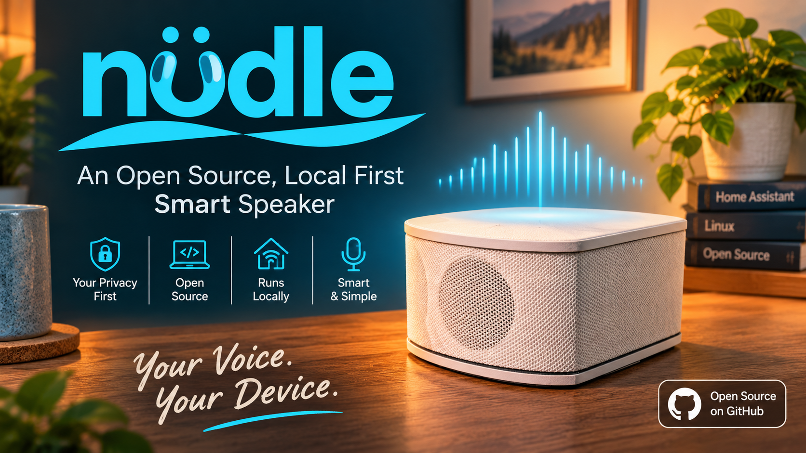

**Nüdle** (pronounced *"noo-dle"*, with a German **ü**) is a local, privacy-first voice assistant designed to run entirely on your own hardware.

It listens continuously, wakes on a custom wake word, and responds to spoken commands using on-device speech recognition and text-to-speech. No cloud required.

## Capabilities

- Wake word detection (custom OpenWakeWord model)
- Speech-to-text via Whisper (faster-whisper, CPU)
- Speaker recognition and enrollment (pyannote.audio)
- Intent routing: music, radio, time/timers/alarms, weather, personality responses
- Neural text-to-speech via Piper TTS
- Audio ducking during interaction
- Local music library server (FastAPI + mpv)

## Tech Stack

- Python 3.11
- OpenWakeWord (ONNX)
- faster-whisper
- pyannote.audio
- Piper TTS
- sounddevice + PortAudio
- FastAPI + uvicorn
- mpv / mpg123

## Getting Started (NixOS)

### 1. Clone the repo

```bash
git clone git@github.com:GSSparks/nudle.git
cd nudle
```

### 2. Enter the dev shell

```bash
nix develop
```

This will:
- Provide all required system binaries (`mpv`, `piper`, `aplay`, `espeak`, `ffmpeg`, etc.)
- Create a Python 3.11 venv at `.venv/` and activate it
- Install all Python dependencies from `nudle/requirements.txt`
- Start the music backend at `http://localhost:8000`
- Warn you about any missing model files

The first run takes a few minutes to install Python packages. Subsequent runs are instant unless `requirements.txt` has changed.

### 3. Provide model files

Three files are required but not included in the repo:

**Wake word model** — place your `Hey_Noodle.onnx` at:
```
nudle/assets/Hey_Noodle.onnx
```
You can substitute any OpenWakeWord-compatible `.onnx` model and update the path in `nudle/main.py`.

**Speaker embedding model** — download the pyannote wespeaker-voxceleb-resnet34-LM model weights and place them at:
```
nudle/models/pyannote_embedding/pytorch_model.bin
```

**Piper TTS voice** — download the Lessac medium voice:
```bash
mkdir -p nudle/tts/voices
piper --download-voice en_US-lessac-medium --output-dir nudle/tts/voices
```

### 4. Run the assistant

```bash
python nudle/main.py
```

The music backend is already running from the dev shell. To restart it after making changes:

```bash
nudle-backend
```

## Getting Started (Raspberry Pi 400)

```bash
git clone git@github.com:GSSparks/nudle.git
cd nudle
bash install_nudle_pi400.sh
source .venv/bin/activate
pip install -r nudle/requirements.txt
```

Then follow step 3 above to add model files, and run:

```bash
python nudle/main.py
```

For the music backend on the Pi:

```bash
cd nudle && uvicorn audio.backend:app --host 0.0.0.0 --port 8000
```

## Speaker Enrollment

Say **"my name is [name]"** after the wake word. Nüdle will walk you through speaking five samples to enroll your voice. After enrollment it will immediately test recognition.

To re-enroll, say the same phrase again — the existing profile will be cleared and replaced.

Speaker profiles are stored in `~/.nudle/speakers/`.

## Music

The music backend indexes MP3s from `/home/gsparks/server/Music` by default. Update `LOCAL_MUSIC_DIR` in `nudle/audio/backend.py` to point at your library.

Supported commands:
- "play [song title]"
- "play album [album name]"
- "play [artist name]"
- "play genre [genre]"
- "skip" / "next"
- "stop" / "pause"

## Adding Intents

Create `nudle/intents/myintent.py` with:

```python
def can_handle(text: str) -> bool: ...
def handle(text: str) -> str: ...
```

Then add it to the import list and the `handle_command()` loop in `nudle/main.py`.

Return a `dict` from `handle()` to trigger a conversational follow-up:

```python
return {"prompt": "How long?", "intent": "myintent", "expect": "duration"}
```

## Status

Actively under development. Not yet intended for general use.
