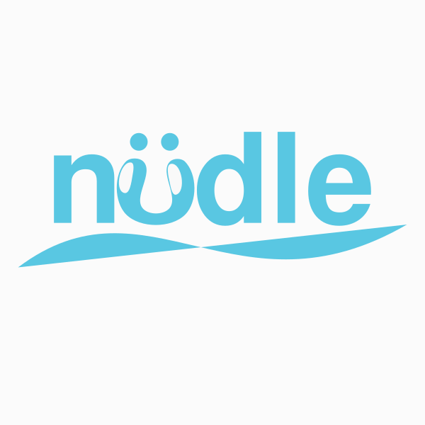

**nudle** (pronounced *“nü-dle”*, like *noodle* with a German **ü**) is a local, privacy-first voice assistant designed to run entirely on your own hardware.

It listens continuously, wakes on a wake word, and responds to spoken commands using on-device speech recognition and text-to-speech—no cloud required.

## Goals

- Fully local voice assistant
- Wake word + speech-to-text + intent handling
- Fast, lightweight, and hackable
- Designed for Linux / NixOS environments
- Easy to extend with new intents

## Current Capabilities

- 🎧 Live microphone input
- 🗣️ Wake word detection
- 🧠 Speech-to-text via Whisper
- 🗂️ Intent routing (music, radio, time, weather, gags, etc.)
- 🔊 Text-to-speech responses
- 🔉 Audio ducking during interaction

## Tech Stack

- `Python 3.11`
- `sounddevice` + `PortAudio`
- `Whisper` (faster-whisper)
- `WebRTC VAD`
- `Piper TTS`

## Status

This project is **actively under development** and not yet intended for public use. APIs, structure, and behavior may change frequently.

## Name

*Nüdle* is pronounced like **“noo-dle”** — the **ü** sounds like *“oo”*.

---

More documentation will come once the core behavior stabilizes.

